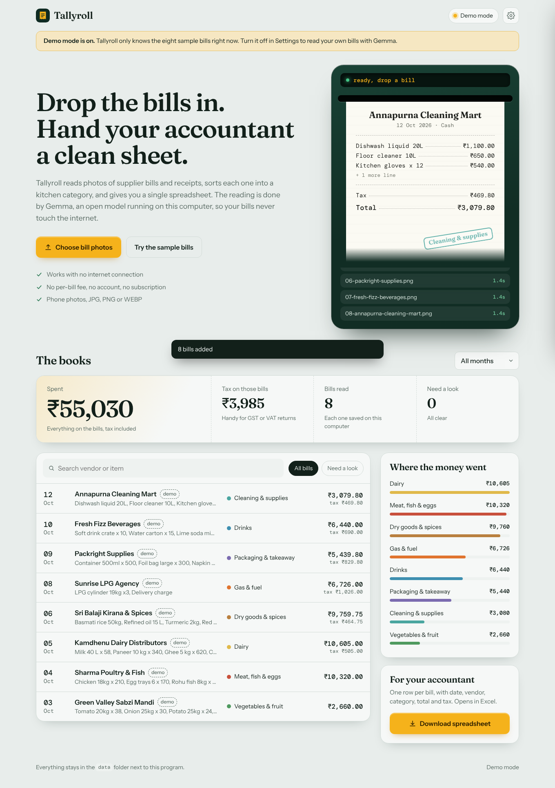

# Tallyroll

**A private bill sorter for small restaurants.** Drop in photos of supplier bills and receipts. [Gemma](https://ai.google.dev/gemma), an open-weight model running on your own computer through [Ollama](https://ollama.com), reads each one, sorts it into a kitchen category, flags anything doubtful, and exports one spreadsheet for your accountant.

No cloud. No per-bill fee. No account. Works offline.



## Run it (Windows)

Full beginner guide: **[WINDOWS-GUIDE.txt](WINDOWS-GUIDE.txt)**. The short version:

1. Install [Python](https://www.python.org/downloads/) (tick "Add python.exe to PATH") and [Ollama](https://ollama.com/download).
2. Double-click `setup-model.bat` (downloads Gemma once).
3. Double-click `start.bat`.

macOS / Linux: `ollama pull gemma3:4b && python3 server.py`

No packages to install. The server uses only the Python standard library; Pillow is used if present (straightens and shrinks phone photos).

## How it works

```
browser (static/)  --raw image-->  server.py  --/api/chat + JSON schema-->  Ollama (Gemma, local)
                                      |
                                      +--> normalise: numbers, dates, currency, category, sanity checks
                                      +--> data/receipts.json + data/images/   (your computer only)
```

- **Structured output.** The request carries a JSON schema (`format`), so Gemma answers in a fixed shape with the category limited to the list in `server.py`.
- **Don't trust the model blindly.** `normalise()` fixes number and date formats (`1,234.50`, `Rs. 9,759.75`, `09-Oct-26`, day-first or month-first), drops unknown categories, and marks a bill "Check" when the vendor, date or total is missing, when line items don't add up to the total, when the model says it's hard to read, or when it looks like a duplicate.
- **Human in the loop.** Every bill opens next to its photo for one-click correction.
- **Local only.** The server binds to `127.0.0.1` and rejects cross-origin writes.
- **Demo mode** (Settings) replays eight bundled sample bills without a model, and tags every record `demo`.

## Tests

```
python -m unittest discover -s tests -v
```

Runs in GitHub Actions on every push (`.github/workflows/test.yml`).

## Limits (honest list)

- Photos only (JPG, PNG, WEBP). PDFs aren't read yet.
- Small models misread digits on blurry bills. That's what the "Check" flag and the photo-beside-numbers view are for.
- On a laptop without a GPU a bill takes tens of seconds to a couple of minutes.
- Sample bills in `sample-receipts/` are made up. Vendors and numbers are fictional.

## Licence

MIT. Fonts: Fraunces, Instrument Sans and DM Mono (SIL OFL), bundled via Fontsource.
